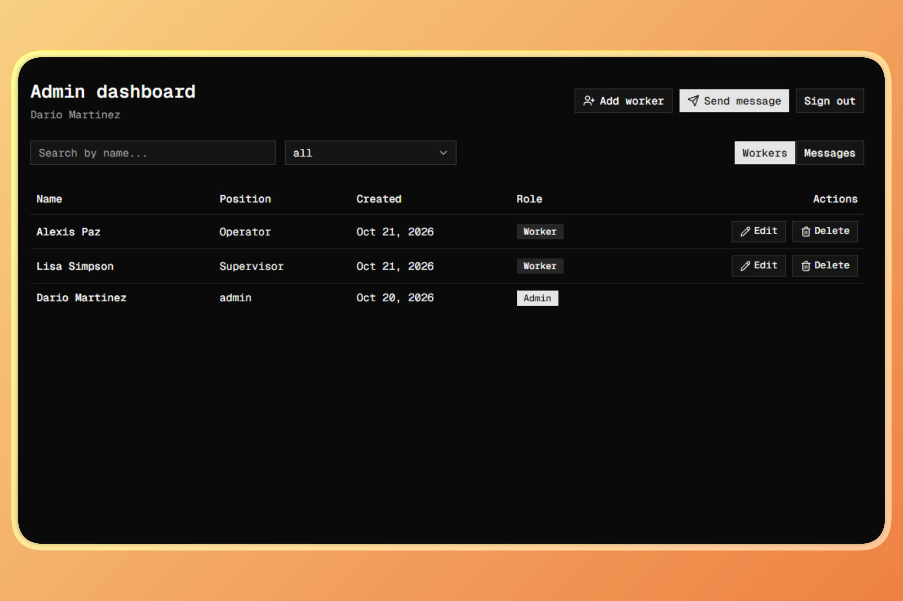
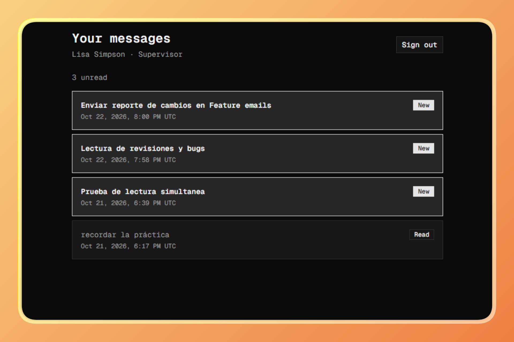
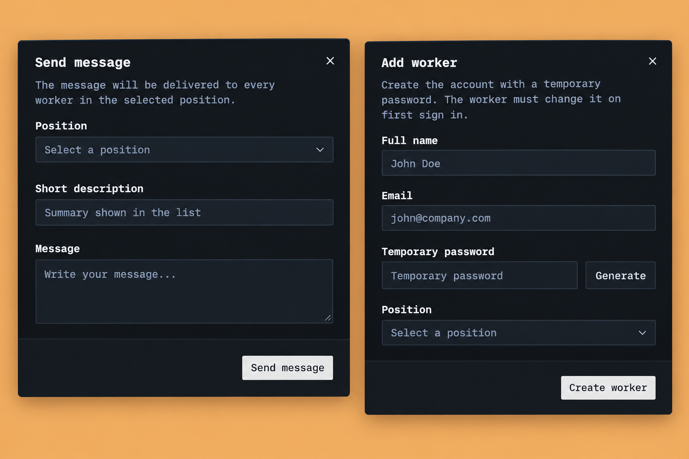
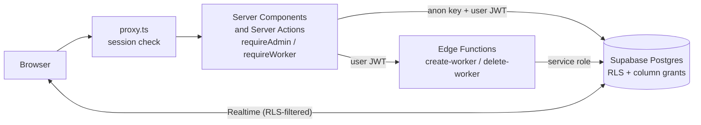
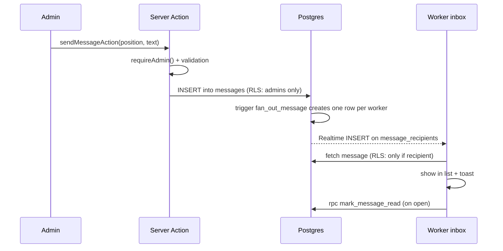
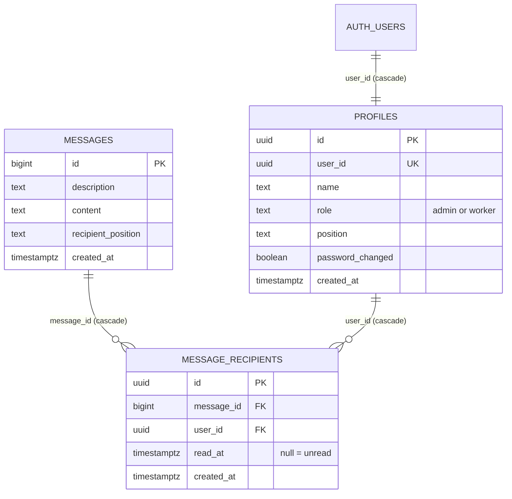

# TeamNotify

**Real-time internal messaging for teams, with role-based access, built security-first on Next.js and Supabase.**

An admin sends a message to a *position* (e.g. "Warehouse"); every worker in that position gets it instantly in their own inbox, with read tracking. Workers never see messages meant for other positions, and nobody can bypass the rules, not even by calling the API directly.






---

## At a glance

| | |
|---|---|
| **What it is** | A two-sided app: an **admin dashboard** and a **worker inbox**. |
| **Who it is for** | Teams that need reliable, targeted internal announcements instead of chat groups. |
| **Highlights** | Real-time delivery with toast alerts, read receipts, forced password change on first login, defense-in-depth security, 55+ automated security checks. |
| **Stack** | Next.js (App Router) · TypeScript · Tailwind v4 · shadcn/ui · Supabase (Postgres, Auth, RLS, Realtime, Edge Functions) |

## Table of contents

1. [Why it matters](#why-it-matters)
2. [Features](#features)
3. [User experience](#user-experience)
4. [Tech stack](#tech-stack)
5. [Architecture](#architecture)
6. [Security](#security)
7. [Technical documentation](#technical-documentation)
8. [Project structure](#project-structure)
9. [Getting started](#getting-started)
10. [Testing](#testing)
11. [Production checklist](#production-checklist)
12. [Known limitations](#known-limitations)

---

## Why it matters

Announcements sent through group chats get buried, reach the wrong people, and leave no trace of who actually read them. TeamNotify fixes that:

- **Targeted:** messages go to a position, not to everyone.
- **Accountable:** each worker has a read receipt per message.
- **Instant:** workers see new messages live, with a notification.
- **Controlled:** accounts are created by an admin, never self-registered, and roles are enforced in the database, not just in the UI.
- **Reusable:** positions, copy and branding live in one config file, so the same codebase fits any team.

## Features

**Admin dashboard**
- Create workers with a temporary password (with a built-in generator) and a position.
- Change a worker's position or delete the worker (with confirmation).
- Send messages to a position; open, **re-target** (change position) or delete sent messages.
- Search by name, filter by position, toggle between *Workers* and *Messages* views.

**Worker inbox**
- Own messages only, newest first, unread highlighted with a "New" badge and an unread counter.
- Opening a message marks it as read.
- Live updates: new messages appear with a toast; deleted or re-targeted messages disappear.

**Accounts and access**
- Email + password sign in, forgot-password flow, and a mandatory password change on first login.
- Two roles only: `admin` and `worker`.

## User experience

**Admin**
1. Signs in and lands on `/dashboard`.
2. Adds a worker (name, email, temporary password, position) and shares the credentials.
3. Sends a message to a position and sees it in the *Messages* view.
4. Can re-target the message later: the previous position loses it, the new one receives it.

**Worker**
1. Receives credentials, signs in, and is **forced to choose a new password** before seeing anything else.
2. Lands on `/inbox`: a list of messages for their position.
3. A toast announces each new message while they are online; unread ones stand out.
4. Opens a message to read it; it is marked as read.
5. Forgot the password? Requests a reset link from the login screen.

**Edge cases handled:** an account without a profile lands on a "No access" page (no redirect loops); expired or reused reset links show a clear message; the reset button has a cooldown that matches the provider's limit.

## Tech stack

| Area | Technology |
|---|---|
| Framework | Next.js 16 (App Router, Server Components, Server Actions, `proxy.ts`), React 19 |
| Language | TypeScript |
| Styling / UI | Tailwind CSS v4, shadcn/ui, lucide-react, sonner (toasts), Geist Mono, dark theme |
| Backend | Supabase: PostgreSQL, Auth, Row Level Security, Realtime, Edge Functions (Deno) |
| Auth integration | [`@dariomvg/create`](https://www.cli.dariomvg.com) CLI (Supabase `basic-auth` module) + `@supabase/ssr` |
| Tooling | Node.js 22+, a security test script built on `@supabase/supabase-js` |

## Architecture



**Sending a message**



**Key design decisions**
- **Three layers of defense** (proxy, server guards, database), so a failure in one does not expose data.
- **The service role never reaches the app or the browser.** It only lives inside two Edge Functions.
- **Business rules live in the database** (triggers and functions), so they hold no matter which client calls the API.
- **The URL is the source of truth for dashboard filters,** so views are shareable and data is fetched filtered on the server.

## Security

Defense in depth: every sensitive operation is checked at several independent levels.

| Layer | What it does |
|---|---|
| **`proxy.ts`** | Refreshes the session and redirects visitors without a session to `/login`. It only answers "is there a session?"; it is deliberately not the only protection. |
| **Server guards** (`lib/auth/session.ts`) | `requireAdmin()`, `requireWorker()` and `requirePendingPasswordChange()` validate the session **against Supabase**, load the profile and check role and password status on every page and every Server Action. |
| **Server Actions** | Re-check the admin role, validate and sanitize all input (types, lengths, UUIDs, allowed positions) and never trust the client. |
| **Row Level Security** | Workers read only their own profile, recipient rows and delivered messages; only admins write messages. |
| **Column-level privileges** | Even where an UPDATE is allowed by RLS, only specific columns can change (`profiles.position`, `messages.recipient_position`). `role`, `name` and `password_changed` can never be changed from a client, which blocks privilege escalation. |
| **`SECURITY DEFINER` functions** | Narrow, audited entry points (`mark_message_read`, `mark_password_changed`) that can only touch the caller's own row. Trigger functions are not executable by clients. |
| **Edge Functions** | Validate the caller's token against the Auth server, confirm `admin` in the database, validate input, and are the only place the service role exists. Admins cannot be deleted through them. |
| **Realtime** | Subscriptions respect the same RLS policies. A test verifies one worker cannot receive another worker's events. |

**Other protections**
- Public sign-up is disabled: accounts exist only if an admin creates them.
- First-login password change is enforced on the server, not only in the UI.
- The auth callback validates its `next` parameter (internal paths only), preventing open-redirect phishing.
- User text is rendered as plain text (React escaping); search input is escaped so `%` and `_` match literally.
- No secrets in the client: only the public URL and anon key are exposed (`NEXT_PUBLIC_*`).
- Database failures are logged on the server only; the user always sees a generic message, never internals.
- Accounts without a profile are sent to a dedicated page instead of failing open.

**Automated verification:** `scripts/security-tests.mjs` attacks the live API the way a real attacker would (anon key + user tokens). See [Testing](#testing).

## Technical documentation

### Database (`supabase/supabase.sql`)



`message_recipients` has a unique `(message_id, user_id)`. Deleting an auth user cascades to their profile and receipts; deleting a message cascades to its receipts.

### Row Level Security and privileges

| Table | Worker | Admin |
|---|---|---|
| `profiles` | SELECT own row | SELECT all; UPDATE only `position` |
| `messages` | SELECT only messages delivered to them | SELECT all; INSERT; DELETE; UPDATE only `recipient_position` |
| `message_recipients` | SELECT own rows | SELECT all |

No client can INSERT/UPDATE/DELETE `message_recipients` or INSERT/DELETE `profiles` directly. Anonymous visitors have no access to anything.

### Functions and triggers inside Supabase

| Name | Type | Purpose | Callable by |
|---|---|---|---|
| `is_admin()` | SQL function (definer) | Used by RLS policies to check the caller's role without recursion | RLS / authenticated |
| `fan_out_message()` + trigger `on_message_created` | Trigger | On message insert, creates one receipt per worker in that position | Database only |
| `resync_message_recipients()` + trigger `on_message_position_updated` | Trigger | When the position changes, removes old receipts and delivers to the new position (unread) | Database only |
| `mark_message_read(bigint)` | RPC (definer) | Sets `read_at` once, only for the caller's own receipt | Authenticated workers |
| `mark_password_changed()` | RPC (definer) | Flags the caller's profile after a successful password change | Authenticated (called from a server action) |

### Edge Functions (`supabase/functions/`, Deno)

Both are called **from Server Actions**, never from the browser, and both validate the caller themselves (deploy with *Verify JWT* off).

| Function | Request | Behavior | Responses |
|---|---|---|---|
| `create-worker` | `POST { name, email, password, position }` | Verifies caller is admin, creates a confirmed auth user with the temporary password, inserts the `worker` profile (rolls back the user if that fails) | `200` ok · `400` invalid_input / weak_password · `401` · `403` · `409` email_exists · `500` |
| `delete-worker` | `POST { userId }` | Verifies caller is admin, only deletes `worker` accounts (never admins, never yourself); cascade removes profile and receipts | `200` ok · `400` · `401` · `403` · `404` · `500` |

### Server Actions (`src/app/dashboard/actions.ts`, `src/lib/auth/password-actions.ts`)

`sendMessageAction`, `deleteMessageAction`, `updateMessagePositionAction`, `updateWorkerPositionAction`, `createWorkerAction`, `deleteWorkerAction` (each starts with `requireAdmin()`), and `changePasswordAction` (updates the password, then calls `mark_password_changed`).

### Authentication

Authentication uses the **Supabase `basic-auth` module generated by the [`@dariomvg/create`](https://www.cli.dariomvg.com) CLI**, installed in `src/lib/auth/supabase/basic-auth/`:

- Sign in/out, current user (validated against Supabase), forgot/reset password, `requireAuth()`.
- `proxy.ts` (from the CLI, adapted) refreshes the session on every request.
- The CLI only copies code. Everything on top is custom: role guards, profile loading, forced password change, the role router at `/`, and the UI.
- Two small adjustments were made to CLI-installed files: `proxy.ts` (routes, redirect target, matcher) and the callback `route.ts` (validated `next`).

### Routes

| Route | Access | Purpose |
|---|---|---|
| `/` | Signed in | No UI: redirects by role/state |
| `/login` | Public | Sign in |
| `/forgot-password`, `/reset-password` | Public / recovery session | Password recovery |
| `/change-password` | Worker with temporary password | Mandatory first-login change |
| `/dashboard` | Admin | Manage workers and messages |
| `/inbox` | Worker | Read messages |
| `/no-access` | Signed in, no profile | Safe landing page |
| `/api/auth/callback` | Public | Exchanges the email/OAuth code for a session |

### Configuration (`src/lib/config.tsx`)

One file holds all copy, SEO metadata, routes and the list of **positions**. Edit `positions` to adapt the app to a different team. Language and theme: English content, dark mode only.

## Project structure

```
.
├── scripts/
│   └── security-tests.mjs            # Attack simulation against the live API
├── supabase/
│   ├── supabase.sql                  # Full schema: tables, functions, triggers, RLS, grants, realtime
│   └── functions/
│       ├── create-worker/index.ts    # Edge Function (Deno)
│       └── delete-worker/index.ts    # Edge Function (Deno)
├── src/
│   ├── proxy.ts                      # Session refresh + redirect for unauthenticated visitors
│   ├── app/
│   │   ├── layout.tsx                # Font, dark mode, metadata, toaster
│   │   ├── page.tsx                  # Role router (no UI)
│   │   ├── login/ forgot-password/ reset-password/ change-password/ no-access/
│   │   ├── dashboard/                # page.tsx + actions.ts (Server Actions)
│   │   ├── inbox/                    # Worker inbox page
│   │   └── api/auth/callback/route.ts
│   ├── components/
│   │   ├── auth/                     # Login, forgot/new password forms, sign-out
│   │   ├── dashboard/                # Header, filters, tables, dialogs
│   │   ├── inbox/                    # Realtime message list
│   │   └── ui/                       # shadcn/ui components
│   └── lib/
│       ├── config.tsx                # Copy, SEO, routes, positions
│       ├── format.ts                 # Date formatting
│       ├── utils.ts                  # shadcn helper
│       ├── auth/
│       │   ├── session.ts            # Auth context + role guards
│       │   ├── password-actions.ts   # Password change server action
│       │   └── supabase/basic-auth/  # Generated by @dariomvg/create
│       ├── data/                     # Server-side queries (dashboard, inbox)
│       └── supabase/server.ts        # Supabase server client for data queries
├── .env.example
└── .env.test.example
```

## Getting started

### Prerequisites
Node.js 22+, a Supabase project, and the shadcn/ui CLI.

### 1. Install

```bash
npm install
cp .env.example .env.local     # then fill in the values
```

Add the shadcn components the UI uses:

```bash
npx shadcn@latest add button input label card table dialog alert-dialog select textarea badge sonner
```

In `src/components/ui/sonner.tsx`, set the toaster theme to `"dark"` (the app has no theme switcher).

### 2. Create the database
Supabase Dashboard → **SQL Editor** → paste and run `supabase/supabase.sql` on a fresh project.

### 3. Configure Supabase Auth
Authentication settings:
- **Sign In / Providers → disable "Allow new users to sign up"** (accounts are created by admins only).
- **Password minimum length:** 8.
- **URL Configuration:** set *Site URL* and add `<SITE_URL>/api/auth/callback**` to *Redirect URLs*.
- **Emails → SMTP Settings:** the built-in email service has a very low hourly limit and is meant for testing. Configure your own SMTP provider for real use (see [Known limitations](#known-limitations)).

### 4. Create the first admin
1. Authentication → Users → **Add user** (tick *Auto Confirm User*).
2. In the SQL Editor:

```sql
insert into public.profiles (user_id, name, role, password_changed)
select id, 'Your Name', 'admin', true
from auth.users
where email = 'admin@yourcompany.com';
```

### 5. Deploy the Edge Functions
**Without the CLI:** Edge Functions → *Deploy a new function* → *Via Editor*. Create `create-worker` and `delete-worker` (exact names), paste each `index.ts`, deploy, then turn **"Verify JWT" off** for both (they validate the token themselves).

**With the Supabase CLI:**

```bash
supabase functions deploy create-worker --no-verify-jwt
supabase functions deploy delete-worker --no-verify-jwt
```

`SUPABASE_URL` and `SUPABASE_SERVICE_ROLE_KEY` are injected automatically; no secrets to set.

### 6. Customize and run
Edit `positions` (and copy) in `src/lib/config.tsx`, then:

```bash
npm run dev
```

Sign in with the admin, create a worker, and send a message.

## Testing

`scripts/security-tests.mjs` simulates real attacks with the anon key and user tokens against the live API: anonymous access, privilege escalation, cross-position reads, direct writes to protected tables, RPC abuse, Edge Function authorization, realtime isolation and unauthenticated route access. It creates tagged test messages and deletes them at the end.

```bash
cp .env.test.example .env.test.local        # fill in an admin and two workers (different positions)
npm run dev                                  # in another terminal (for the route checks)
node --env-file=.env.local --env-file=.env.test.local scripts/security-tests.mjs
```

Node 22+ is needed for the realtime checks (global `WebSocket`); otherwise they are skipped. Any `FAIL` line means a protection is missing.

The SQL schema was also validated on a clean PostgreSQL instance: it applies without errors, and fan-out, re-targeting, cascades and the permission model behave as documented.

## Production checklist

- [ ] Environment variables set in the host, with `NEXT_PUBLIC_SITE_URL` as the real domain.
- [ ] Real domain added to Supabase *Redirect URLs* (`<domain>/api/auth/callback**`).
- [ ] Public sign-up is still disabled.
- [ ] Custom SMTP configured (and sender domain verified).
- [ ] Supabase Pro plan if used for a real client (the free plan pauses inactive projects and caps Realtime connections).
- [ ] Real admin created with `password_changed = true`; test accounts removed or their passwords changed.
- [ ] `scripts/security-tests.mjs` passes with no `FAIL`.

## Known limitations

- Password-change enforcement relies on the `password_changed` flag; a technical user could call `mark_password_changed()` without changing the password (it affects only that flag).
- The Edge Functions do not rate-limit; only admins can use them.
- Tables show up to 200 rows (no pagination yet).
- Positions are defined in `config.tsx`; the database stores them as free text.
- Workers created after a message was sent do not receive earlier messages; re-targeting a message resets its read status.
- Realtime DELETE events cannot be filtered: each client receives the IDs of deleted receipts and ignores those that are not theirs (no content is exposed).
- Supabase's built-in email service is limited to a few emails per hour, which affects password recovery in development.

## Author

Built by **Dari** · [cli.dariomvg.com](https://www.cli.dariomvg.com)